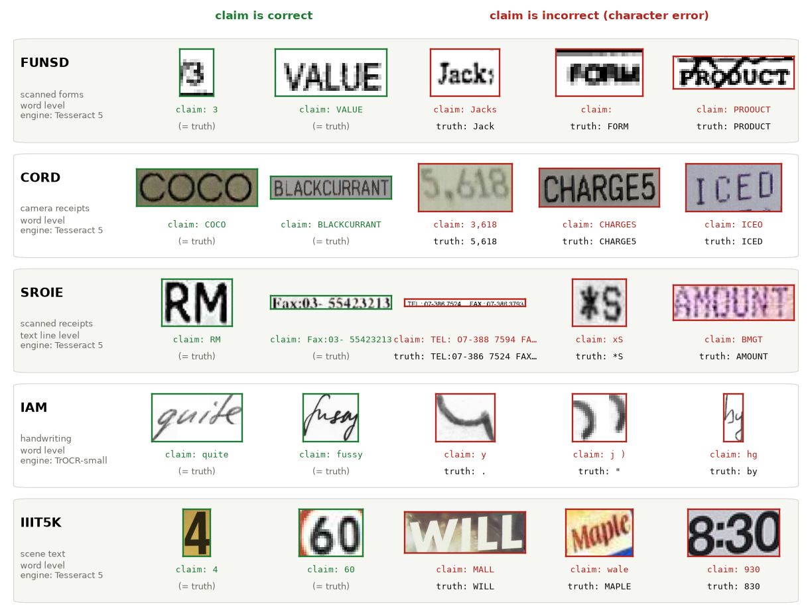

# LOCUS: Verifying OCR by Local Optimality over Counterfactual String Graphs

Code, benchmark definition and raw results for the paper
*LOCUS: Verifying OCR by Local Optimality over Counterfactual String Graphs*
(Shikhar Dubey, Sanhita Saxena, Vikash Tripathi, Syed Abbas; IIT Mandi).

OCR engines always return a transcription. **LOCUS** decides whether to trust it by asking whether the
claimed string is the *best explanation of the image among the strings it could have been confused with*:

1. **Counterfactual string graph.** Around each claim `h`, build a small graph of OCR-plausible single edits
   (confusable substitutions, case flips, deletions/insertions) and the readings of two frozen recognisers.
2. **Render-normalised evidence.** Score every hypothesis `v` with
   `rho_V(v) = s_V(v | x) - s_V(v | R(v))`: its teacher-forced log-likelihood on the real crop minus that on a
   clean rendering of `v`. This cancels the recogniser's prior over strings. Recognisers: TrOCR-base and PARSeq, both frozen.
3. **Relation-aware GNN** (GATv2 with typed edit edges) with a local-optimality readout `P_opt(h | G)`, which also gives a repair proposal.
4. **Label-free pretraining** on images where two engines agree, plus synthetic OCR-style corruptions. Then
   **few-shot adaptation** from `k` labelled words per class.



## Results (k = 25 labelled words per class)

Macro-F1 / AUROC on the five benchmarks of real OCR errors (ensembles of five support sets):

| Method | FUNSD | CORD | SROIE | IAM | IIIT5K | Avg. F1 | Avg. AUROC |
|---|---|---|---|---|---|---|---|
| Engine confidence | .756 / .861 | .777 / .892 | .780 / .859 | .802 / .878 | .788 / .938 | .781 | .886 |
| ConfidNet-style learned confidence | .771 / .845 | .842 / .929 | .826 / .912 | .801 / .861 | .922 / .980 | .832 | .905 |
| Two-engine voting | .609 / .680 | .772 / .807 | .976 / .976 | .759 / .767 | .862 / .905 | .796 | .827 |
| Re-OCR: TrOCR-base | .605 / .675 | .811 / .841 | **.979** / .978 | .758 / .766 | .952 / .966 | .821 | .845 |
| Re-OCR: Florence-2 | .647 / .715 | .615 / .685 | .478 / .578 | .369 / .522 | .823 / .879 | .586 | .676 |
| Re-OCR: PARSeq (graded) | **.946** / **.976** | .973 / .986 | .742 / .760 | .879 / .914 | **.993** / **.995** | .907 | .926 |
| VLM judge: Qwen2.5-VL-7B | .760 / .846 | .891 / .945 | .866 / .941 | .700 / .788 | .888 / .974 | .821 | .899 |
| **LOCUS** | .943 / .974 | **.978** / **.993** | .973 / **.992** | **.906** / **.969** | .971 / .991 | **.954** | **.984** |

The results are mixed against the strongest baselines:
* LOCUS beats every general-purpose verifier in AUROC on all five datasets.
* Against re-recognition with a strong recogniser, LOCUS is significantly better on IAM, better in AUROC on CORD, tied
  on FUNSD and behind PARSeq on IIIT5K. On SROIE it has higher AUROC but lower F1 than TrOCR.
* The best re-recognition baseline changes from dataset to dataset, so LOCUS has the best average.
* The analyses show that the gain comes from the counterfactual evidence and label-free pretraining, not from message passing.

## Repository layout

| Path | Contents |
|---|---|
| `code/` | full pipeline (crops, OCR, evidence extraction, models, baselines, analysis, tables/figures) |
| `data/<DS>/splits.jsonl` | benchmark definition: crop ids and train/test split |
| `data/<DS>/hyp_{tess,trocr}.jsonl` | the real OCR claims (Tesseract 5, TrOCR-small) and engine confidences |
| `results/*.jsonl` | raw results of every run (one JSON row per method x dataset x k x seed) |
| `results/preds_*.npy`, `repair_*.npy`, `reocr_*.json` | test-set predictions, repair proposals, re-recognition outputs |
| `results/audit/annotations.json` | manual audit labels (G/N/C/A/P) of the sampled crops |
| `paper/` | output folder for generated tables and figures |

The dataset images and ground-truth transcriptions are **not** redistributed (licences of IAM and others).
`extract_crops.py` rebuilds them deterministically from the public releases.

## Reproduction

```bash
conda create -n locus python=3.11 && conda activate locus
pip install -r requirements.txt          # plus a Tesseract 5 binary (apt install tesseract-ocr)
export LOCUS_ROOT=$(pwd)

# 1. public datasets from the Hugging Face Hub -> data_raw/
python code/download.py nielsr/funsd                              data_raw/nielsr_funsd/ds
python code/download.py naver-clova-ix/cord-v2                    data_raw/naver-clova-ix_cord-v2/ds
python code/download.py priyank-m/SROIE_2019_text_recognition     data_raw/priyank-m_SROIE_2019_text_recognition/ds
python code/download.py priyank-m/IAM_words_text_recognition      data_raw/priyank-m_IAM_words_text_recognition/ds
python code/download.py MiXaiLL76/IIIT5K_OCR                      data_raw/MiXaiLL76_IIIT5K_OCR/ds

# 2. crops + manifests (seeded), real OCR claims
python code/extract_crops.py
python code/ocr_hyp.py

# 3. evidence, baselines, LOCUS runs, figures/tables (see pipeline*.sh for the exact order used)
bash code/run_all.sh
bash code/finalize.sh
```

A full run takes about six GPU-hours on RTX A6000 GPUs. Every table and figure is generated from `results/`
by `make_assets.py`, `make_analysis.py`, `make_qual2.py` and `make_datafig.py`; no number is entered by hand.

Protocol notes:
* The Hugging Face FUNSD boxes are on the LayoutLM 0-1000 grid and must be rescaled before cropping.
* SROIE ground truth is all upper case, so labels are case-insensitive.
* IIIT5K uses the case-insensitive alphanumeric protocol, and every verifier receives the canonical claim.

## Related publication

This work extends the conference paper
*Reading Between the Characters: Label-Efficient OCR Verification with Graph Neural Networks*
(Sanhita Saxena, Vikash Tripathi, Syed Abbas; NICCAI 2026, Hyderabad, to appear).
That paper verifies OCR few-shot with character-level relational line graphs on a private dataset. LOCUS replaces it with a
segmentation-free counterfactual string graph and render-normalised evidence, and evaluates on five public benchmarks.

## Citation

```bibtex
@article{dubey2026locus,
  title  = {{LOCUS}: Verifying {OCR} by Local Optimality over Counterfactual String Graphs},
  author = {Dubey, Shikhar and Saxena, Sanhita and Tripathi, Vikash and Abbas, Syed},
  year   = {2026},
  note   = {Under review}
}

@inproceedings{saxena2026reading,
  title     = {Reading Between the Characters: Label-Efficient {OCR} Verification with Graph Neural Networks},
  author    = {Saxena, Sanhita and Tripathi, Vikash and Abbas, Syed},
  booktitle = {Proceedings of NICCAI 2026, Hyderabad, India},
  year      = {2026},
  note      = {To appear}
}
```

## License

Code: MIT (see `LICENSE`). Datasets remain under their original licences.
