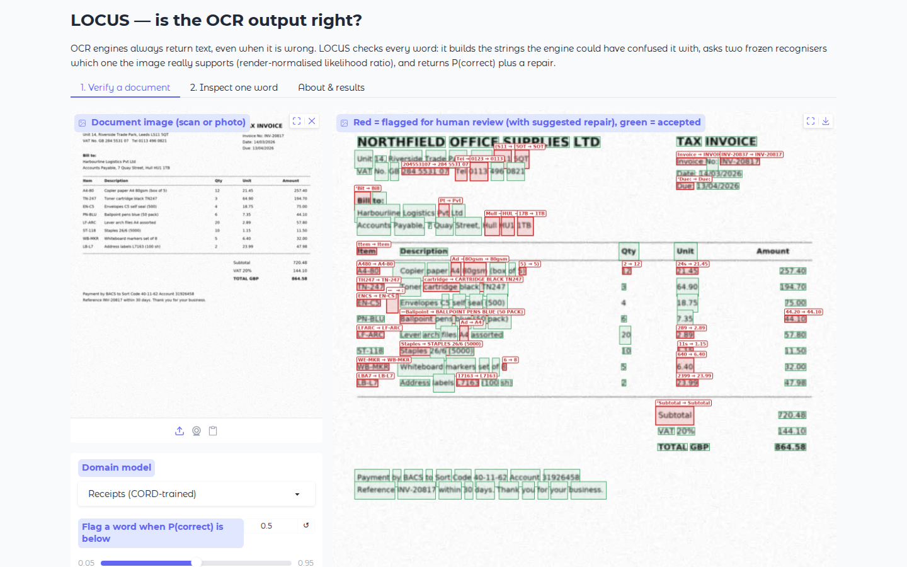

# LOCUS demo application

A web app that puts LOCUS after an OCR engine. Upload a scanned or photographed document and:
1. Tesseract 5 reads it;
2. LOCUS checks every word and returns P(correct);
3. words below the threshold are flagged for human review, with a suggested repair.

The rest of the page is accepted automatically.

**Video:** [`media/LOCUS_demo.mp4`](media/LOCUS_demo.mp4) (about 2.5 minutes). It covers:
* the problem;
* how LOCUS decides on one word, using live model output;
* a real screen recording of this app;
* measured results;
* applications and limitations.



## Run

```bash
pip install -r requirements.txt -r app/requirements.txt     # + apt install tesseract-ocr
python app/app.py              # http://localhost:7860   (--share for a temporary public link)
```
The app needs a GPU for practical speed (about 18 words/s on an RTX A6000). On first use it downloads TrOCR-base and PARSeq.

## Tabs
* **Verify a document:**
  * the page with red boxes (flagged, with the suggested repair) and green boxes (accepted);
  * the flagged word crops;
  * a table of every word, least trustworthy first;
  * the text with repairs applied;
  * a JSON report.
* **Inspect one word:** the verdict, the counterfactual string graph (node size = P_opt, colour = ρ), every hypothesis
  with its ρ under TrOCR and PARSeq, and the real crop next to clean renderings R(v).
* **About & results:** the method, the paper's benchmark numbers and the limitations.

## Files
| File | Purpose |
|---|---|
| `app.py` | Gradio application |
| `locus_engine.py` | inference: Tesseract word boxes → evidence extraction and graph construction (imported unchanged from `code/`) → LOCUS GNN → few-shot head |
| `models/locus_<DS>.pt` | deployable LOCUS per domain (200 KB each): label-free pretrained GNN (seed 0), normaliser and the k = 25 fusion head |
| `export_models.py` | recreates `models/` from the research data and records each model's held-out test scores |
| `make_demo_docs.py` | synthetic degraded invoice, receipt and claim form with word-level truth (`examples/`) |
| `evaluate_demo.py` | measures the pipeline on those pages against Tesseract confidence and PARSeq re-reading (`examples/demo_eval.json`) |
| `record_app.py` | drives the running app in headless Chromium; screen recording and screenshots in `media/` |
| `make_video.py` | builds `media/LOCUS_demo.mp4` from live model output, `demo_eval.json`, the paper's tables and the recording |

## Exported models: held-out test scores (k = 25, seed 0)

| Model | Macro-F1 | AUROC |
|---|---|---|
| SROIE | .969 | .992 |
| CORD | .959 | .993 |
| FUNSD | .942 | .956 |
| IAM | .905 | .964 |
| IIIT5K | .972 | .987 |

These are within about 0.01 of the paper's five-seed ensemble.

## Measured on the bundled demo pages (CORD-trained model, threshold 0.5)

| Page | Tesseract words | OCR errors | LOCUS flags | errors caught | Tesseract confidence, same number flagged | PARSeq disagreement |
|---|---|---|---|---|---|---|
| Invoice | 145 | 38 | 38 | 37 | 23 | 38 of 39 flagged |
| Receipt | 84 | 30 | 28 | 28 | 20 | 28 of 30 flagged |
| Claim form | 69 | 10 | 11 | 10 | 5 | 10 of 11 flagged |

On these synthetic pages, flagging disagreement with PARSeq is about as good as LOCUS. The paper shows that the best
re-reading baseline changes between datasets: PARSeq reaches only F1 .742 on SROIE, for example. LOCUS is near the best
on all five benchmarks.

Two notes on the app:
* **Default model.** The CORD-trained model is the default because it did best on these pages.
* **Repair casing.** When a repair equals PARSeq's reading up to letter case, the app shows PARSeq's casing. This is
  for display only and does not change P(correct).
